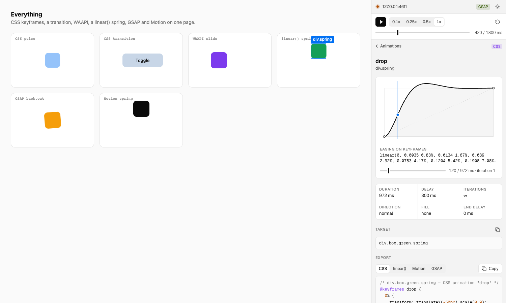
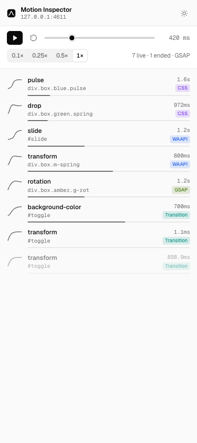
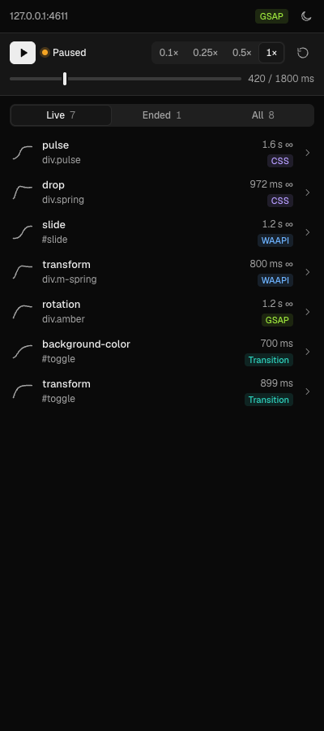
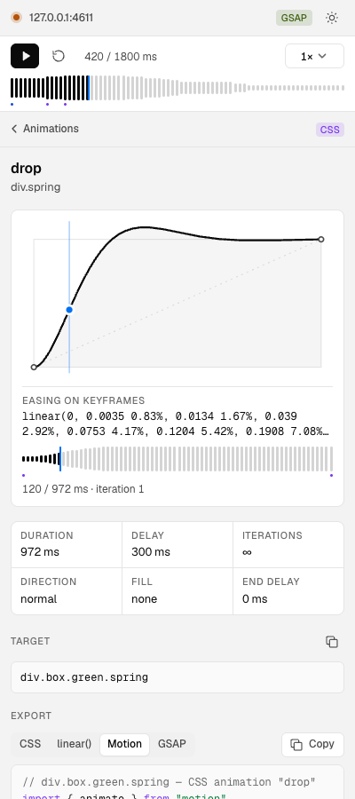
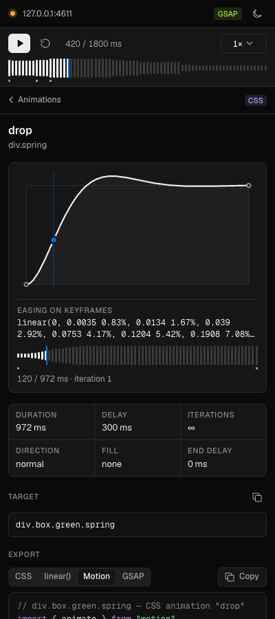
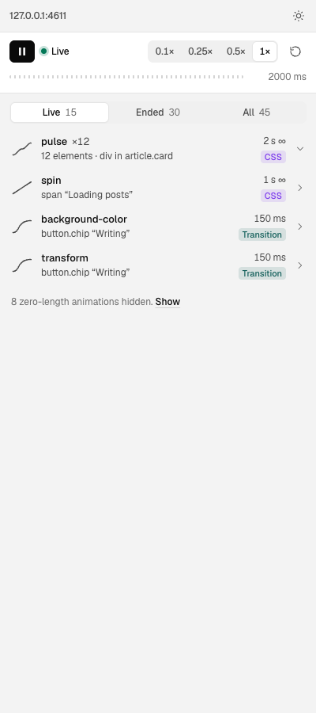
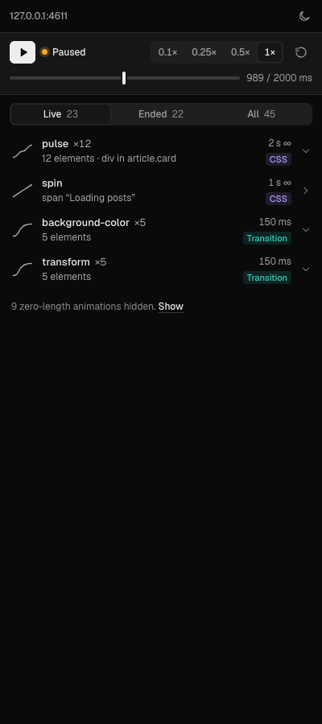
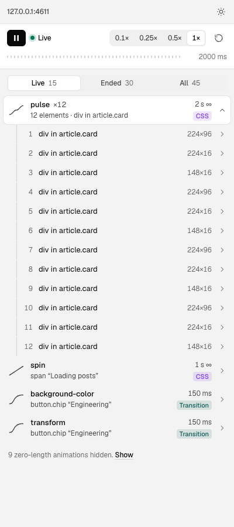
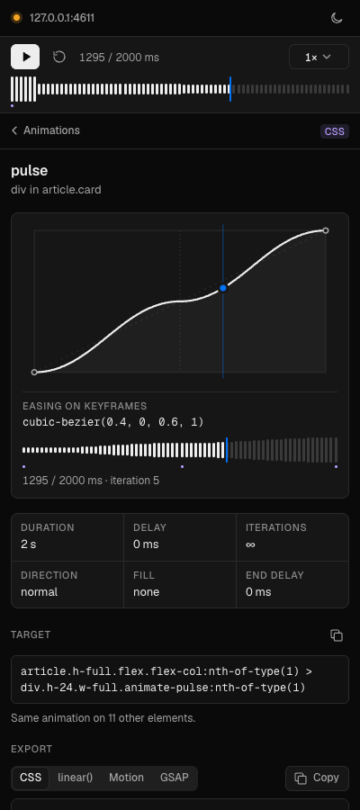

# Motion Inspector



> A Chrome extension that pauses and scrubs the animations running on any page, reads off each one's easing, duration, delay, iterations and animated properties, and exports it as code: CSS, a CSS `linear()` easing, Motion, or GSAP. Built in vanilla TypeScript on WXT.

Chrome DevTools' Animations panel can already inspect and scrub. It doesn't give you code. That's the gap this fills: find an animation you like, pause it, and copy it out in the format you work in.

It lives in Chrome's side panel, so it stays open while you hover, click and scroll the page.

## Screenshots

| Light | Dark |
| ----- | ---- |
|  |  |
|  |  |
|  |  |
|  |  |

## Install (no Node required)

1. Grab the latest zip from [**Releases**](https://github.com/akintola4/motion-inspector/releases/latest): `motion-inspector-<version>-chrome.zip`.
2. Unzip it anywhere.
3. Open `chrome://extensions`, turn on **Developer mode** (top right), click **Load unpacked** and pick the unzipped folder.
4. Pin **Motion Inspector** from the puzzle menu.

Click the icon on any page and the side panel opens.

> Updates aren't automatic. When a new release lands, download the new zip and click **Update** on the extension card. Version history is in [CHANGELOG.md](./CHANGELOG.md).

Needs Chrome 116 or newer (side panel API). Edge, Brave, Arc and other Chromium browsers with side panel support should work the same way; only Chrome has been tested.

## How to use

- **Open the panel** on the tab you want to inspect. It follows the active tab and re-attaches after reloads.
- **Pause / play** everything with the button, `Space` or `K`. GSAP's global timeline pauses with it. The dot before the site name in the header says whether the page is **Live** (green) or **Paused** (amber).
- **Scrub** with the waveform. Its bars show how many animations are running at each moment of the timeline, and the small coloured marks under it show where animations start (coloured by kind: CSS, transition, WAAPI, GSAP). While the page is live the bars sit still in one muted tone with no playhead. Grab them and everything pauses and moves to the same time from its start, the model DevTools uses; the played part turns solid and a blue playhead marks the time. Hover to preview a time and what runs there without moving anything.
- **Step frames** with `,` / `.` or `←` / `→` (`Shift` for 10 frames). On the focused scrubber, `Home` / `End` jump to the ends and `Page Up` / `Page Down` move 10%. `R` restarts.
- **Slow it down** from the speed menu (0.1×, 0.25×, 0.5×, 1×) or with `J` (slower) and `L` (faster, and plays). The rate also applies to animations that start later.
- **The list** shows what's running now (**Live**); **Ended** and **All** are one click away. Identical animations on many elements fold into one row (`pulse ×12`) that expands to the elements, with their size so you can tell them apart. Zero-length animations are hidden behind a note. Rows name the element the way you would (`button.chip “Design”`, `div in article.card`), not with a selector path. Hover a row to outline its element on the page; `↑`/`↓` move between rows, `→`/`←` open and close a group, `Enter` opens.
- **Open an animation** to drill into it (`Escape` or the back button returns to the list where you left it). The element stays outlined on the page and the detail view shows:
  - the easing curve with a playhead, and the easing as written;
  - a scrubber for that one animation, drawn as a waveform of its eased value with its keyframes marked underneath. Loops scrub within the current iteration and say which one (`372 / 2000 ms · iteration 14`);
  - duration, delay, iterations, direction, fill, end delay;
  - the full selector, copyable;
  - the export, in four tabs: **CSS**, **linear()**, **Motion**, **GSAP**, with a Copy button;
  - the keyframes.
- **Catching hover transitions:** pause first, then hover. New animations are held the moment they start, and finished ones stay under **Ended** so you can still export them.

### What the exports do

| Tab | Output |
| --- | --- |
| CSS | `@keyframes` plus an `animation:` rule, or a `transition:` declaration with the from/to states. Per-keyframe easings are kept. |
| linear() | The easing as a CSS `linear()` custom property. Beziers are sampled, springs are labelled with the bounce and duration they match. `steps()` stays `steps()`. |
| Motion | `animate()` for vanilla JS and a `<motion.div>` for `motion/react`. Times in seconds, `repeat`/`repeatType`, keyframe `times`, per-segment `ease` arrays. A `linear()` that looks like a spring is turned back into `type: "spring"` with `visualDuration` and `bounce`. |
| GSAP | `gsap.fromTo()` or percentage `keyframes`. Known curves map to GSAP names (`power4.out`), other beziers use `CustomEase`, anything else gets an exact ease function. Tweens that came from GSAP are echoed with their original vars and ease name. |

## What it can and can't capture

| Source | Captured | Controllable |
| --- | --- | --- |
| CSS `@keyframes` animations | yes | yes |
| CSS transitions | yes, while running (and kept after they end) | yes, while running |
| Web Animations API (`element.animate()`) | yes | yes |
| Motion, values it hands to WAAPI (`opacity`, `transform`, `filter`, `clipPath`, springs on those, and often `x`/`y`) | yes, as WAAPI | yes |
| GSAP tweens and timelines | yes, through `window.gsap` | yes, through the global timeline |
| Anything driven by `requestAnimationFrame` (Motion values it runs on the main thread, anime.js, React Spring, hand-rolled loops) | detected only: listed as **JS-driven** when an element's inline style changes many times a second | no |
| Scroll-driven animations (`animation-timeline: scroll()`/`view()`) | listed, tagged "scroll" | no |
| Canvas, WebGL, Lottie (canvas renderer), SMIL `<animate>` | no | no |
| Cross-origin iframes, closed shadow roots | no | no |

A few things worth knowing:

- Motion decides per value whether to use WAAPI or JS, so the same `animate()` call can show up as WAAPI, as WAAPI with dozens of pre-sampled keyframes, or as JS-driven. In testing with Motion 14, a spring with `repeatDelay` ran in JS while the same spring without it went to WAAPI as `linear()`.
- GSAP tweens inside a timeline export as standalone tweens, with a comment giving their position in the timeline.
- Chrome shortens a CSS transition that reverses mid-flight, so an interrupted hover can report a duration much shorter than the one in your stylesheet. That's what the browser actually ran.
- Chrome doesn't let extensions run on `chrome://` pages or the Web Store. The panel says so.

## Permissions

- `sidePanel` for the panel itself.
- `scripting` and host access to all sites, to inject the inspector into the tab you're looking at.

There are no declared content scripts. Nothing runs on a page until the side panel is open and pointed at it, and when the panel closes, the page is resumed at 1×. `activeTab` alone isn't enough here: its grant is lost on every navigation, and a side panel that sits open across reloads would keep losing access.

## Development

```bash
pnpm install        # also copies the Geist fonts into public/fonts/
pnpm build          # → dist/chrome-mv3/, load it unpacked
pnpm dev            # WXT dev mode with reload
pnpm zip            # → dist/motion-inspector-<version>-chrome.zip
```

```bash
pnpm test           # vitest: easing parser, spring fit, every exporter
pnpm compile        # tsc --noEmit
pnpm e2e            # build, then drive the extension in Playwright Chromium
pnpm fixtures       # serve fixtures/ on http://localhost:4599
pnpm icons          # rasterize public/icon.svg
```

`pnpm e2e` loads the built extension into Playwright's Chromium, opens each fixture page, and checks that the panel lists the right animations, that pause freezes `currentTime`, that scrubbing and frame steps set it, that the rate and the keyboard work, that every export tab produces code, and that closing the panel leaves the page running at 1×. It also asserts that nothing moves when you use the transport, that the transport lines up to the pixel (one centre line, one left edge and one right edge), and that the panel never scrolls sideways at side-panel widths from 300 to 600px. `pnpm audit:layout` reports every layout shift in detail (see `docs/layout-audit.md`), and `pnpm shots:transport` saves the transport's states to `screenshots/transport/`. It also writes the screenshots in `screenshots/`. Playwright can't click the toolbar icon or read the real side panel's DOM, so the UI checks run on the same panel page opened in a tab with `?tabId=<fixture tab>`. One extra check opens the real side panel with `chrome.sidePanel.open` and confirms it follows the active tab and injects the inspector.

The fixtures cover CSS `@keyframes`, CSS transitions, WAAPI with a cubic-bezier, a spring via `linear()`, a GSAP timeline, Motion's `animate()`, a noisy Tailwind-style page (twelve `animate-pulse` skeletons, chips flipping every 180 ms, zero-length WAAPI calls) that checks grouping, the ended filter and the iteration readout, and a page with about 100 animations and long names for narrow panels. GSAP and Motion are served from `node_modules`, no CDN.

## Architecture

```
entrypoints/
├── background.ts        # opens the panel from the toolbar; resets pages when it closes
├── agent.ts             # injected into the page (MAIN world) on demand: capture,
│                        # controls, GSAP, highlight overlay, JS-driven detection
└── sidepanel/
    ├── main.ts          # tab tracking, polling, keyboard
    ├── transport/       # play, restart, readout, speed menu, waveform scrubbers
    │   ├── transport.ts # global transport and the detail scrubber
    │   ├── waveform.ts  # device-pixel bars, playhead, hover preview
    │   └── scrubber.ts  # role=slider engine: pointer, keys, ARIA
    ├── bridge.ts        # every agent call is one chrome.scripting.executeScript
    ├── list.ts          # keyed, grouped rows, updated in place; keyboard nav
    ├── detail.ts        # drill-in view: curve, scrubber, timing, export tabs
    ├── curve.ts         # SVG curves
    └── style.css

lib/
├── easing.ts            # parse / evaluate / sample to linear() / spring + spring fit
├── gsap-eases.ts        # GSAP ease names ↔ beziers
├── timing.ts            # iteration position, per-animation scrub range, curves
├── grouping.ts          # fold identical animations, live/ended filter, no-op check
├── label.ts             # human labels for elements (skips Tailwind utilities)
├── selector.ts          # short unique selectors
└── export/              # css, linear, motion, gsap: pure functions, unit-tested

fixtures/                # test pages
scripts/                 # fixture server, e2e, icon + font helpers
docs/plan.md             # design notes and v1 scope
docs/transport-research.md  # media player anatomy behind the transport
```

## Tech

- [WXT](https://wxt.dev) for the MV3 build.
- TypeScript strict, with `exactOptionalPropertyTypes` and `noUncheckedIndexedAccess`. No UI framework, just a small `h()` DOM helper.
- [Geist](https://vercel.com/font) for the UI, Geist Mono for code. Same tokens as its sibling extension, RPC.
- [Vitest](https://vitest.dev) and [Playwright](https://playwright.dev) for tests.

## License

MIT.
