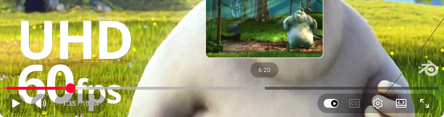
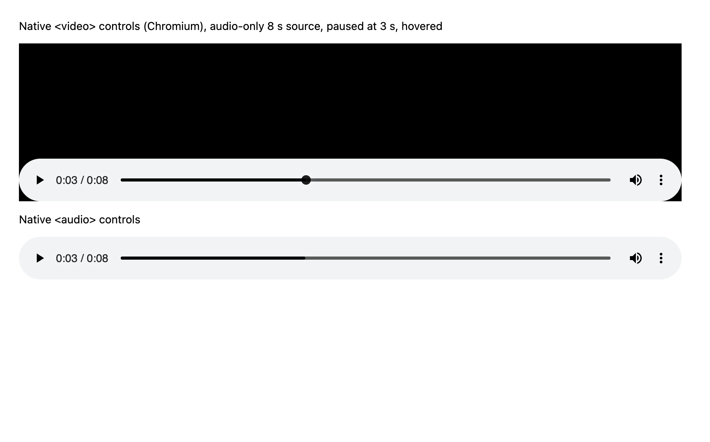

# Transport research: the anatomy of media players

Research for redesigning the panel's transport (play/pause, speed, scrubber,
time readout, restart) by borrowing from music and video players. It covers
what the parts are called, how the good players behave, and which ideas fit
an animation inspector. The three options built from this are listed at the
end.

Screenshots in `docs/transport-research/` were taken with Playwright for this
doc. Behaviour I could not confirm from a primary source is marked
*(observed)* or *(unconfirmed)*.

## What we have today

`[pause] [0.1× 0.25× 0.5× 1×] … [restart]`, then a full-width native range
input and a `2000 ms` readout. While the page plays, the track is dashed and
has no thumb, and the readout shows only the length. Once paused, a 4×16px
bar thumb appears and the readout becomes `588 / 2000 ms`. The detail view
has a second range input with `372 / 2000 ms · iteration 14`.

Things that don't work well yet: the dashed live track reads as "loading";
there's no frame step and no keyboard beyond Space; the bar is only 4px tall
and you can't tell the hit area is bigger; the time has no sense of
remaining or position along the bar.

## Anatomy: the names of the parts

| Term | What it is | Where it shows up |
| --- | --- | --- |
| **Transport** | The whole group of playback controls: play/pause, stop, step, shuttle, loop, rate, position. The word comes from tape machines ("transport" moved the tape). | DAWs (Ableton, Logic), NLEs, the DevTools Animations toolbar |
| **Scrubber / seek bar** | The control that sets the play position by dragging. YouTube's help calls the knob itself "the scrubber, the red dot in the progress bar". | Every player |
| **Track** | The full-length rail the scrubber runs along. | |
| **Fill / progress** | The played part of the track, from 0 to the current position. Apple Music on iOS 16 draws it as the same line at a higher opacity ([Six Colors](https://sixcolors.com/post/2022/07/scrubbing-through-ios-16s-music-app/)). | |
| **Buffered range** | A lighter band showing what is downloaded. A loaded-ahead hint, not a position. | YouTube, native `<video>` |
| **Thumb / knob** | The handle on the track. Native Chromium media controls only show it on hover (see screenshot). | |
| **Playhead** | The current-position marker in an editor: a vertical line through the timeline, usually with a head on the ruler. Final Cut defines it as the mark that "stays fixed until you move it" ([Apple FCP guide](https://support.apple.com/guide/final-cut-pro/ver8e3f32f0/mac)). | NLEs, DAWs, DevTools, Theatre.js, Rive |
| **Skimmer / hover preview** | A second, temporary line or tooltip that follows the pointer without moving the playhead. Final Cut: the skimmer "lets you preview clips … without affecting the playhead position". YouTube shows a frame thumbnail and the time above the bar. | Final Cut, YouTube |
| **Elapsed / remaining / duration** | Time since the start; time left (shown with a minus sign); the total. Apple puts elapsed under the left end and `−remaining` under the right end. Native controls show `0:03 / 0:08`. | |
| **Timecode** | An editor-style position readout in fixed fields, read like a clock. | Premiere, FCP, Ableton's arrangement position |
| **Ruler** | Tick marks with time labels along the top of a timeline; minor and major ticks. | NLEs, DAWs, DevTools |
| **Markers / chapters / ticks** | Named points or segments on the bar. YouTube chapters are "marked by a vertical line in the progress bar" and the chapter title shows while you hover ([YouTube Help](https://support.google.com/youtube/answer/12825599)). SoundCloud pins comments as avatars at their timestamp on the waveform ([Signal v. Noise](https://signalvnoise.com/posts/1143-soundcloud-expands-the-audio-player)). | |
| **In / out points, work area** | A sub-range to play or loop. Premiere uses I and O; Rive's work area "sets the playback range" ([Rive docs](https://rive.app/docs/editor/animate-mode/timeline)). | |
| **Loop toggle** | Repeat the range. Rive offers One-Shot, Loop and Ping-Pong per timeline. | |
| **Playback rate** | Speed multiplier. DevTools Animations offers 100%, 25% and 10% presets ([OpenClassrooms](https://openclassrooms.com/en/courses/5625816-create-modern-css-animations/6155536-refine-your-animations-with-chrome-s-animation-tool)); Apple Podcasts uses one button that cycles speeds on each tap *(observed)*. | |
| **Step forward / back** | Move one frame while paused. YouTube: `,` and `.`; Premiere: ← and → ([U-M ITS](https://its.umich.edu/communication/collaboration/google/accessibility/youtube), [NoFilmSchool](https://nofilmschool.com/2018/10/how-use-j-k-and-l-keys-premiere-pro-speed-your-workflow)). | |
| **Shuttle (J/K/L)** | J plays backwards, K stops, L plays forwards; pressing J or L again speeds up, Shift+J/L goes slow. | Premiere, FCP, Avid; YouTube borrows J/K/L as −10 s / pause / +10 s |
| **Waveform** | The bar drawn as the signal's amplitude, so you can see where things happen before you scrub there. | SoundCloud |

## Player by player

**Apple Music, iOS.** Since iOS 16 the whole bar is the touch target: you
no longer have to hit the small dot, and the played part is the same line at
a different opacity ([Six Colors](https://sixcolors.com/post/2022/07/scrubbing-through-ios-16s-music-app/)).
On press, the bar visibly thickens and the time labels underneath get
brighter while you hold *(observed; Apple documents the swelling for the
volume slider, which "swells and lights up when you adjust it",
[TechRadar](https://www.techradar.com/news/ios-16-three-essential-apple-music-upgrades))*.
Elapsed sits under the left end, `−remaining` under the right end, and a
small badge (Lossless, Dolby Atmos) sits centred between them. **Fine
scrubbing:** press, then move your finger away from the bar vertically to
step down from Hi-Speed to Half-Speed, Quarter-Speed and Fine scrubbing; the
mode name appears above the bar ([How-To Geek](https://www.howtogeek.com/254608/how-to-scrub-through-audio-and-video-slowly-in-ios/),
[iMore](https://www.imore.com/tip-audio-scrubbing-ios-beginner)). Sources
disagree on whether you drag up or down (a [VLC issue](https://code.videolan.org/videolan/vlc-ios/-/issues/1270)
reports it differs by device), so distance from the bar, either way, is the
safe reading.

**Apple Music, macOS.** Transport centred (back, play, forward), with the
position bar under the "LCD" and times at both ends; the bar only shows a
knob while you hover it *(observed)*.

**Spotify, desktop and mobile.** A thin grey bar with a white fill; on hover
the fill turns the brand green and a round knob appears; elapsed and total
sit inline at both ends *(observed; Spotify doesn't document it, and the
green full-width bar was dropped in 2016, [OMG! Ubuntu](https://www.omgubuntu.co.uk/2016/11/spotify-testing-new-layout-desktop-player))*.
Mobile matches iOS: elapsed under-left, `−remaining` under-right.

**YouTube.** Layers on one bar: track, buffered range (light grey), hover
range, red fill, chapter gaps, red knob. Hovering shows a frame thumbnail
plus the time; the bar itself grows a little on hover. Keyboard: K/Space
play/pause, J/L −/+10 s, ←/→ ±5 s, `,`/`.` one frame while paused, 0–9 jump
to 0–90% ([U-M ITS](https://its.umich.edu/communication/collaboration/google/accessibility/youtube)).
A 2022 experiment added "precise seeking": drag up on the knob to get a strip
of thumbnails ([9to5Google](https://9to5google.com/2022/06/29/youtube-precise-video-scrubbing/)).

**SoundCloud.** The waveform *is* the scrubber: grey for unplayed, orange for
played, cut at the playhead. Comments sit as avatars at their timestamps.
Early praise: the large waveform makes it easier "to set the playhead at the
exact spot you want", better than "an itsy-bitsy slider" on mobile
([Signal v. Noise](https://signalvnoise.com/posts/1143-soundcloud-expands-the-audio-player),
[Ubergizmo](https://ubergizmo.com/2011/10/soundcloud-revamped-app/amp)). The
lesson from the later redesign: markers get cluttered, so keep them small and
reveal details on hover ([UX Planet case study](https://uxplanet.org/improving-soundclouds-app-comment-section-ux-case-study-f10fa5fb8e2c)).

**Ableton Live and Logic.** A transport bar with play, stop and record, a
loop switch, and the arrangement position as a bars/beats/sixteenths readout
in fixed fields. Ableton separates the **playhead** (where playback is) from
the **insert marker** (where it starts next), a distinction users trip on
([Ableton forum](https://forum.ableton.com/viewtopic.php?p=1794048)). The
ruler sits above the tracks; the playhead runs from the ruler down.

**Final Cut and Premiere.** Playhead plus a separate skimmer (FCP), in/out
points (I/O, Shift+I/O to jump to them), frame stepping with ←/→ and Shift
for bigger steps, and J/K/L shuttling where repeated L doubles the speed and
Shift+L gives slow motion ([NoFilmSchool](https://nofilmschool.com/2018/10/how-use-j-k-and-l-keys-premiere-pro-speed-your-workflow),
[PremiumBeat](https://www.premiumbeat.com/blog/beginners-guide-to-premiere-pro-shortcuts/)).
The timecode readout never changes width.

**Chrome DevTools Animations panel.** The closest neighbour: a toolbar with
pause-all, replay and 100% / 25% / 10% speed buttons, then a ruler with a
draggable playhead, then one bar per animation showing delay and iterations
with keyframe dots. You scrub by dragging along the ruler.

**Rive, Theatre.js, Framer.** Motion tools built on the editor model. Rive
shows the playhead time, duration and speed next to the timeline, with
One-Shot / Loop / Ping-Pong and a work area ([Rive docs](https://rive.app/docs/editor/animate-mode/timeline)).
Theatre.js: Space plays and pauses while the studio has focus, and a focus
range is a Shift-drag on the top bar ([Theatre.js docs](https://www.theatrejs.com/docs/latest/manual/keyboard-shortcuts)).
Framer's timeline is a ruler, a playhead and keyframe diamonds per property.

**Native `<video>` / `<audio>` controls (Chromium).** `0:03 / 0:08` inline
before the bar; a thin bar with a darker fill; the round knob only appears
while the control is hovered or focused.

## What makes them feel good

- **Hit area much bigger than the drawing.** YouTube's bar is a few pixels
  tall (its `.ytp-progress-bar` box measured 6px while hovered, in the run
  that took the screenshot above) and sits in a taller padded container that
  takes the pointer; iOS 16 made the whole bar the target. Our rule: at
  least 24px tall, whatever the track.
- **Grow on press, not on hover alone.** A thicker track while you hold is
  feedback that you've "got" it. Done with `transform: scaleY`, so layout
  never changes, and fast (about 150ms ease-out).
- **The knob is a state, not furniture.** Native controls and Spotify show it
  only on hover or focus; Apple Music has none at rest. For us: no knob while
  live, a knob once paused.
- **Fine scrubbing.** Apple's distance-from-bar precision is the best idea
  here for an animation tool, where the interesting part of a 300ms ease is
  20ms wide.
- **A skimmer that doesn't move the playhead.** YouTube and Final Cut both
  preview where you're pointing without committing to it.
- **Markers you can see before you scrub.** Chapters and SoundCloud's
  waveform tell you where things happen.
- **Timecode that doesn't jiggle.** Tabular figures in fixed-width fields.
  We already have `numSlot`.
- **Keyboard that matches muscle memory.** Space/K play-pause, `,`/`.` one
  frame, ←/→ steps, Shift for bigger steps, J/L shuttle, Home/End.
- **Live vs paused is obvious and not a spinner.** Live radio in Apple Music
  shows "LIVE" over a dim, empty bar rather than a moving fill. That is the
  model for our "page is playing, there is no single position" state.
- **Accessible slider semantics.** The [APG media seek slider](https://www.w3.org/WAI/ARIA/apg/patterns/slider/examples/slider-seek/)
  uses `role="slider"` with `aria-valuetext` in human time ("4 minutes 3
  seconds of 10 minutes"), Arrow keys for small steps, Page Up/Down for big
  ones and Home/End for the ends.

## What we can't borrow

- **Reverse play (J as reverse shuttle).** The agent can't run animations
  backwards across CSS, WAAPI and GSAP, so J/L shuttle the *speed* down and
  up instead.
- **Buffered range.** Nothing loads. The closest equivalent, "where
  animations are active", becomes markers or a waveform.
- **Loop / in-out.** The agent has no loop region. Left out for now.

## Keyboard map used by all three options

| Key | Action | Source |
| --- | --- | --- |
| Space, K | Play / pause | Everywhere; YouTube, NLEs |
| `,` `.` | Back / forward one frame (1/60 s), pauses first | YouTube |
| ← → | One frame; Shift for 10 frames | Premiere, FCP |
| J / L | Slower / faster (0.1× ↔ 1×); L also plays | J/K/L shuttle, adapted |
| Home / End | Start / end of the timeline (on the slider) | APG slider |
| Page Up / Down | ±10% (on the slider) | APG slider |
| R | Restart | (ours) |

## The three options

**A. Now Playing (Apple Music).** A thin track with times at both ends
(elapsed left, `−remaining` right), a round knob once paused, a track that
thickens on press, and fine scrubbing by dragging away from the bar.
Controls centred: step back, play, step forward; speed is a single pill that
cycles on click, like Apple Podcasts. The detail scrubber puts elapsed and
remaining under the bar with the iteration as a centred badge, like the
Lossless badge.

**B. Editor (DAW / NLE / DevTools).** A ruler with minor and major ticks and
labels, a playhead line with a head, a timecode readout in fixed fields, a
frame-step and shuttle cluster, and speed as a compact stepper. The detail
scrubber is a ruler over the iteration with keyframe diamonds.

**C. Waveform (SoundCloud + YouTube).** The track is drawn as a waveform of
how many captured animations are running at each moment, split at the
playhead into played and unplayed, with start and end markers underneath and
a hover preview (time plus what's running there). Speed lives in a popover.
The detail scrubber draws the animation's own eased curve as bars, with
keyframe markers as chapters.

## Sources

- Six Colors, “Scrubbing through iOS 16’s Music app”: https://sixcolors.com/post/2022/07/scrubbing-through-ios-16s-music-app/
- TechRadar, iOS 16 Apple Music upgrades: https://www.techradar.com/news/ios-16-three-essential-apple-music-upgrades
- How-To Geek, scrub audio and video slowly in iOS: https://www.howtogeek.com/254608/how-to-scrub-through-audio-and-video-slowly-in-ios/
- iMore, audio scrubbing on iPhone and iPad: https://www.imore.com/tip-audio-scrubbing-ios-beginner
- VLC for iOS issue 1270, scrubbing direction: https://code.videolan.org/videolan/vlc-ios/-/issues/1270
- OBSlider (a UISlider that reproduces Apple's scrub speeds): https://github.com/reinerspass/OBSlider
- YouTube Help, navigation tips: https://support.google.com/youtube/answer/12825599
- U-M ITS, YouTube keyboard shortcuts: https://its.umich.edu/communication/collaboration/google/accessibility/youtube
- 9to5Google, YouTube precise video scrubbing: https://9to5google.com/2022/06/29/youtube-precise-video-scrubbing/
- Signal v. Noise, “SoundCloud expands the audio player”: https://signalvnoise.com/posts/1143-soundcloud-expands-the-audio-player
- UX Planet, SoundCloud comments case study: https://uxplanet.org/improving-soundclouds-app-comment-section-ux-case-study-f10fa5fb8e2c
- Ubergizmo, SoundCloud mobile revamp: https://ubergizmo.com/2011/10/soundcloud-revamped-app/amp
- OMG! Ubuntu, Spotify desktop player layout: https://www.omgubuntu.co.uk/2016/11/spotify-testing-new-layout-desktop-player
- Ableton forum, insert marker vs playhead: https://forum.ableton.com/viewtopic.php?p=1794048
- Apple, Final Cut Pro skimmer and playhead: https://support.apple.com/guide/final-cut-pro/ver8e3f32f0/mac
- ProVideo Coalition, Option-click to move the FCP playhead: https://www.provideocoalition.com/day-6-28daysofquicktips-option-click-to-move-the-final-cut-pro-x-playhead/
- NoFilmSchool, J/K/L in Premiere Pro: https://nofilmschool.com/2018/10/how-use-j-k-and-l-keys-premiere-pro-speed-your-workflow
- PremiumBeat, Premiere Pro shortcuts: https://www.premiumbeat.com/blog/beginners-guide-to-premiere-pro-shortcuts/
- OpenClassrooms, Chrome's animation tool: https://openclassrooms.com/en/courses/5625816-create-modern-css-animations/6155536-refine-your-animations-with-chrome-s-animation-tool
- Rive, Timeline: https://rive.app/docs/editor/animate-mode/timeline
- Theatre.js, keyboard and mouse controls: https://www.theatrejs.com/docs/latest/manual/keyboard-shortcuts
- W3C APG, Media Seek Slider: https://www.w3.org/WAI/ARIA/apg/patterns/slider/examples/slider-seek/

## Outcome

Option C (Waveform) was picked and is now the only transport (0.3.0).
Options A and B and the preview switch were removed. Changes from the
preview, after review in the real side panel:

- The hover preview sits below the bars on a solid surface, clamped inside
  the scrubber, so it never covers the readout or leaves the panel.
- Bars, gaps and the playhead are laid out in whole device pixels from a
  ResizeObserver. The first bar starts on the left gutter and the last ends
  on the right gutter. When the width can't be split evenly, a few gaps get
  one extra device pixel.
- Start markers stay. At the narrowest width (300px, about 55 bars) one
  marker per bar is still readable. They're coloured by animation kind, and
  the hover preview names what starts there (`13 ms · slide +4 starts`).
- The readout uses fixed-width tabular slots with no leading zeros. Geist's
  figure space (U+2007) turned out narrower than its tabular digits, so
  padding with it would still have shifted the text.
- Speed stays a menu. A four-button segment doesn't fit next to play,
  restart and the readout at 300px.
